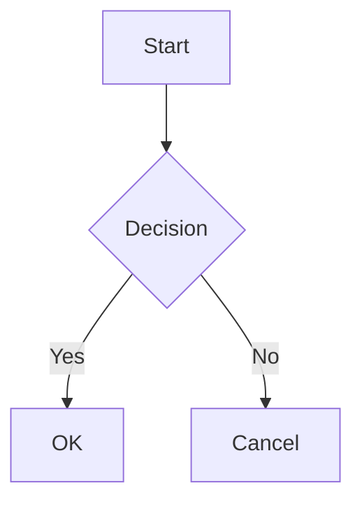

# Features


## Folder Browsing

Open any folder and navigate its directory tree via the sidebar. The sidebar shows directories first (sorted alphabetically), then `.md` files. Dotfiles and non-Markdown files are filtered out.

A breadcrumb bar at the top shows your current location and lets you navigate back to parent directories.

## Multiple Windows

Two folders can be read side by side, each in its own window:

- **File › New Window** (`Cmd+N`) opens an empty window on the home screen.
- **File › Open Folder in New Window…** (`Shift+Cmd+N`) picks a folder and opens
  it in a new window, leaving the current window untouched.

The **Window** menu lists every open window and switches to the one you pick
(the active one is checked). Each window is named after the document it shows —
or its folder when no document is open yet — so the list stays readable.

It also carries the usual macOS window commands:

- **Minimize**, **Zoom**, **Enter Full Screen**
- **Fill** — the window takes the whole screen minus menu bar and Dock
- **Center** — keeps the size, centers the window on its screen
- **Move & Resize** — halves (Left, Right, Top, Bottom), quarters, and **Return
  to Previous Size**, which undoes a run of arrangements in one step
- **Bring All to Front** — raises every window, keeping the active one in front

These act on the frontmost window and use the screen it currently sits on. They
have no keyboard shortcuts on purpose: macOS already binds Control-Option-arrows
to its own window tiling, which keeps working alongside them.

Windows are fully independent — document, outline, search state and scroll
position are per window. Menu commands and their shortcuts (Find, Print, Export
as PDF, Open Recent, Toggle Dark Mode…) act on the frontmost window only.
The recent-files list is shared (the native "Open Recent" submenu is app-wide).
Preferences (theme, fonts, language) are stored once for the app and applied
when a window opens, so changing them updates the window you changed them in and
every window opened afterwards.

## Markdown Rendering

Full GitHub-Flavored Markdown (GFM) support including:

- Headings with auto-generated IDs
- Tables (with extended colspan via `||`)
- Code blocks with syntax highlighting
- Blockquotes
- Task lists with checkboxes
- Strikethrough
- Links and images

## GitHub Alerts

Support for GitHub-style alert callouts:

```markdown
> [!NOTE]
> Useful information

> [!TIP]
> Helpful advice

> [!WARNING]
> Something to be careful about

> [!IMPORTANT]
> Critical information

> [!CAUTION]
> Potential risks
```

## Footnotes

Reference-style footnotes with automatic backlinks:

```markdown
Here is a statement[^1].

[^1]: This is the footnote content.
```

## Math (KaTeX)


Inline math with `$...$` and display math with `$$...$$`:

```markdown
Inline: $E = mc^2$

Display:
$$\int_0^\infty e^{-x^2} dx = \frac{\sqrt{\pi}}{2}$$
```

## Mermaid Diagrams


Fenced code blocks with the `mermaid` language are rendered as diagrams. Each diagram has a fullscreen button for detailed viewing. Syntax errors show the source code as a fallback.

````markdown

````

## Syntax Highlighting

Code blocks are highlighted with [highlight.js](https://highlightjs.org/). Specify the language after the opening fence, or let auto-detection pick it up.

A **Copy** button appears on each code block for quick copying.

## Smart Typography

Straight quotes are automatically converted to curly quotes. Apostrophes, em dashes, en dashes, and ellipses are also handled:

| Input | Output |
|---|---|
| `"hello"` | "hello" |
| `don't` | don't |
| `---` | em dash |
| `--` | en dash |
| `...` | ellipsis |

## Emoji Shortcodes

Over 80 emoji shortcodes are supported:

```markdown
:rocket: :heart: :fire: :star: :tada:
```

## Image Lightbox


Click any image in the rendered Markdown to open it in a fullscreen overlay. Press **Escape** or click outside the image to close.

## Outline Panel

An auto-generated table of contents appears on the right side, built from `h2` and `h3` headings. The active heading is highlighted as you scroll through the document.

## Themes

Ten built-in themes — Speakino, Light, GitHub, Solarized and Sepia, each with a dark counterpart — plus your own, created in **Preferences › Themes** or imported from a JSON file.

With **Follow macOS appearance** on (the default), you pick one theme for light mode and one for dark mode, and the app switches between them with the system. Turn it off to keep a single theme. The theme toggle button (sun/moon icon) in the top bar switches between your light and dark theme at any time. Your choices are persisted across sessions.

## PDF Export

Click the PDF button in the top bar to export the current document as a PDF file. The export uses the native macOS `WKWebView.createPDF` API for high-quality rendering. A save dialog opens with a default filename based on the current markdown file. UI elements (sidebar, outline) are hidden during capture so only the document content is exported.

## Session Persistence

The app remembers the last opened folder and restores it on next launch.

## Open Single Files

You can open individual `.md` files directly:

- **CLI**: `mdv ~/docs/README.md`
- **Finder**: Right-click a `.md` file → "Open With" → Markdown Viewer

The app loads the file and displays its parent directory in the sidebar for easy navigation to related documents. File associations are declared for `.md`, `.markdown`, and `.mdx` extensions.

## Relative Link Navigation

Click any `.md` link in a document to navigate to that file. Anchor links (`#section`) scroll to the target heading. External links open in the default browser.
